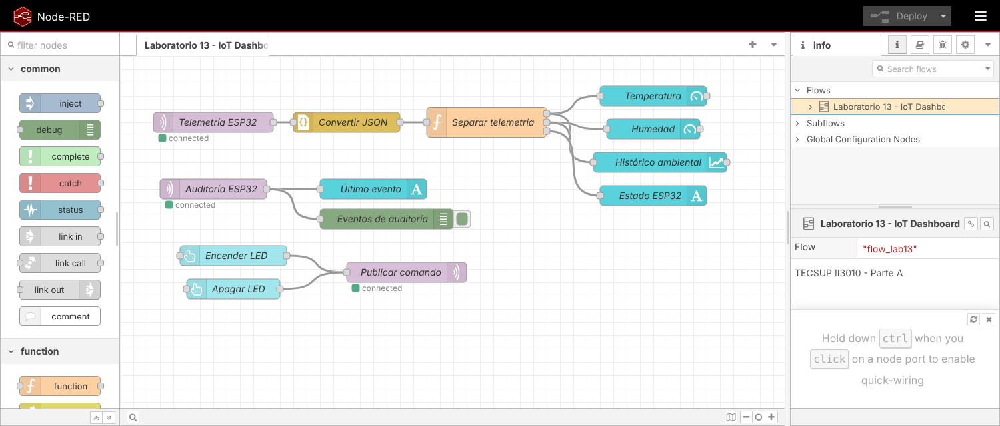
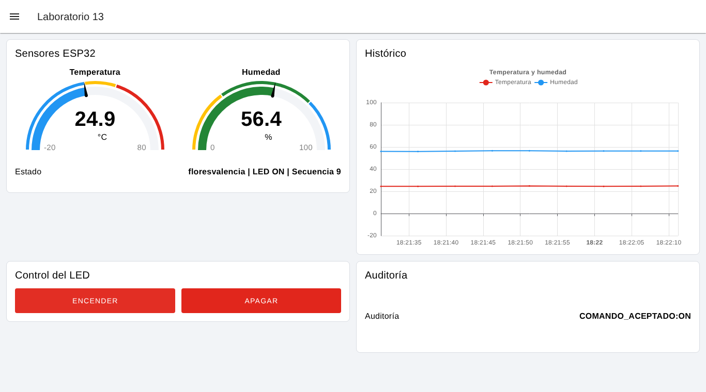
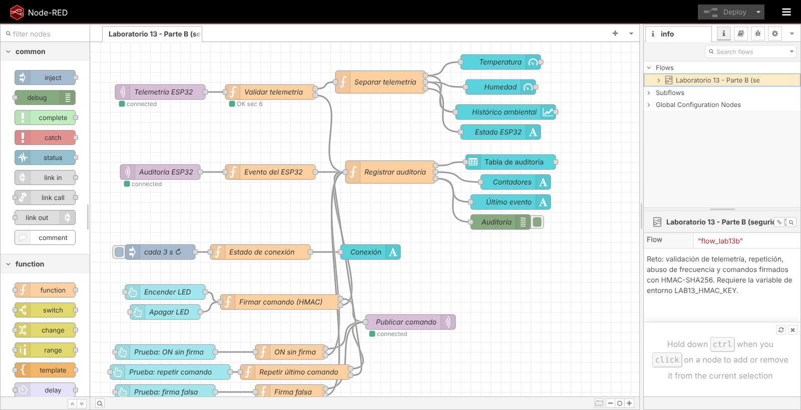
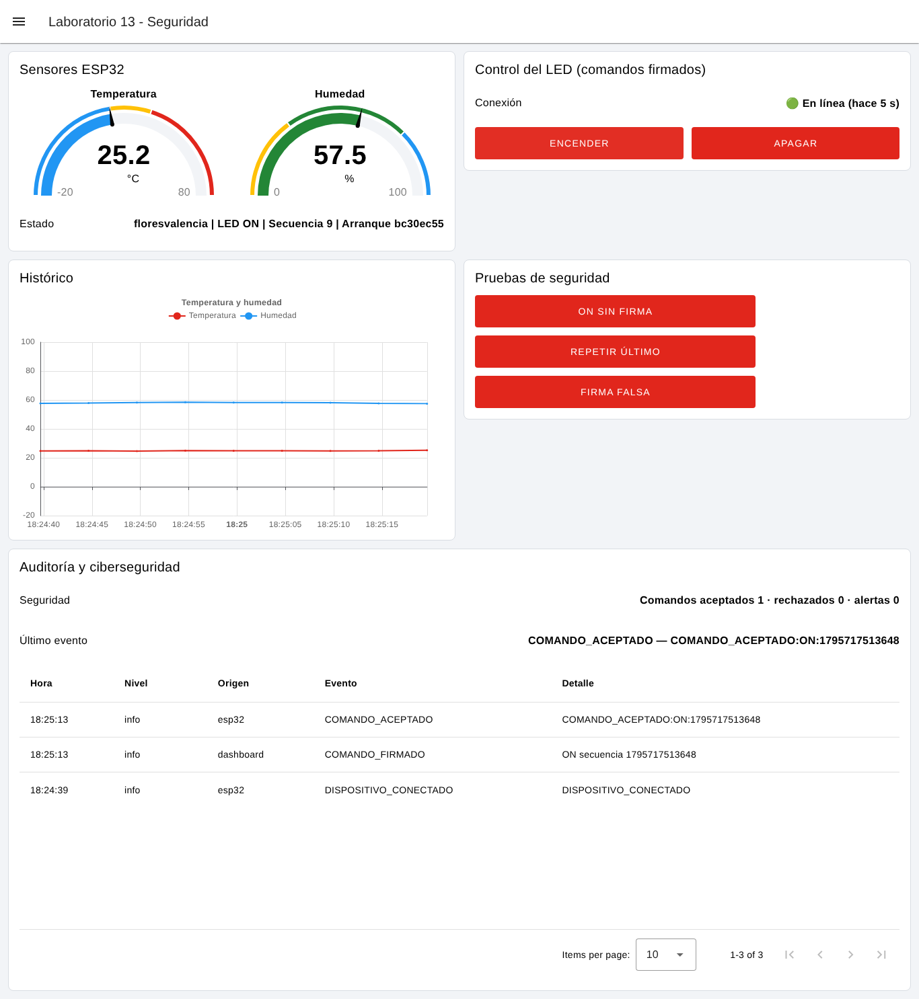
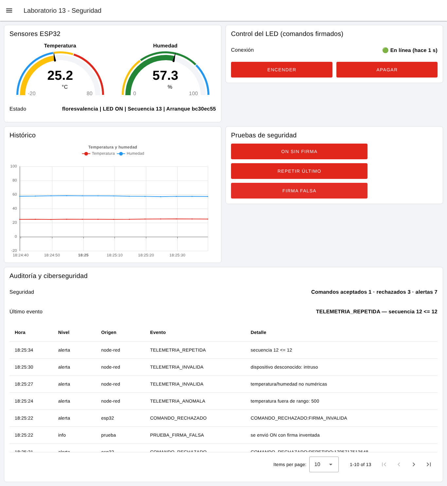
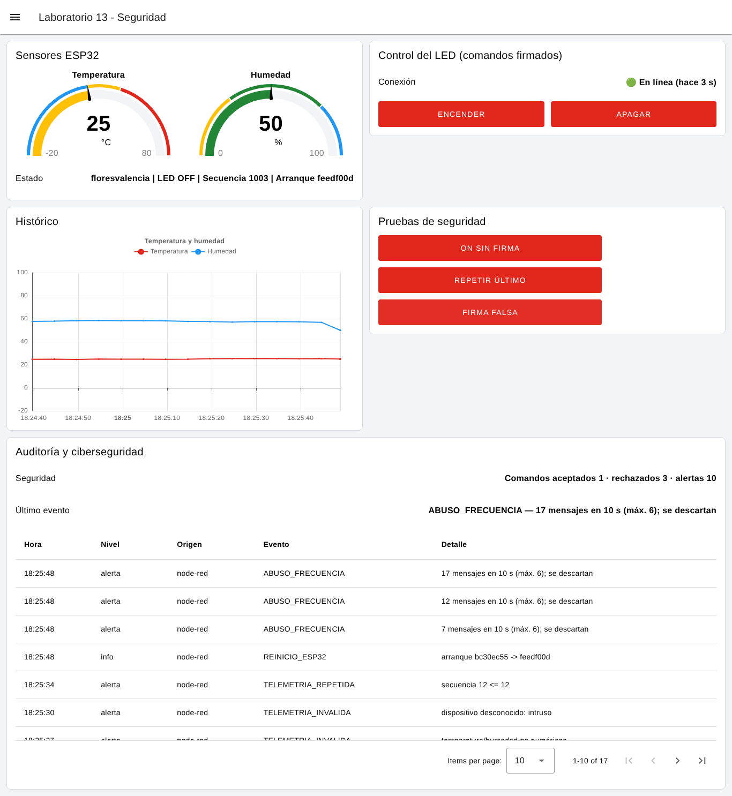
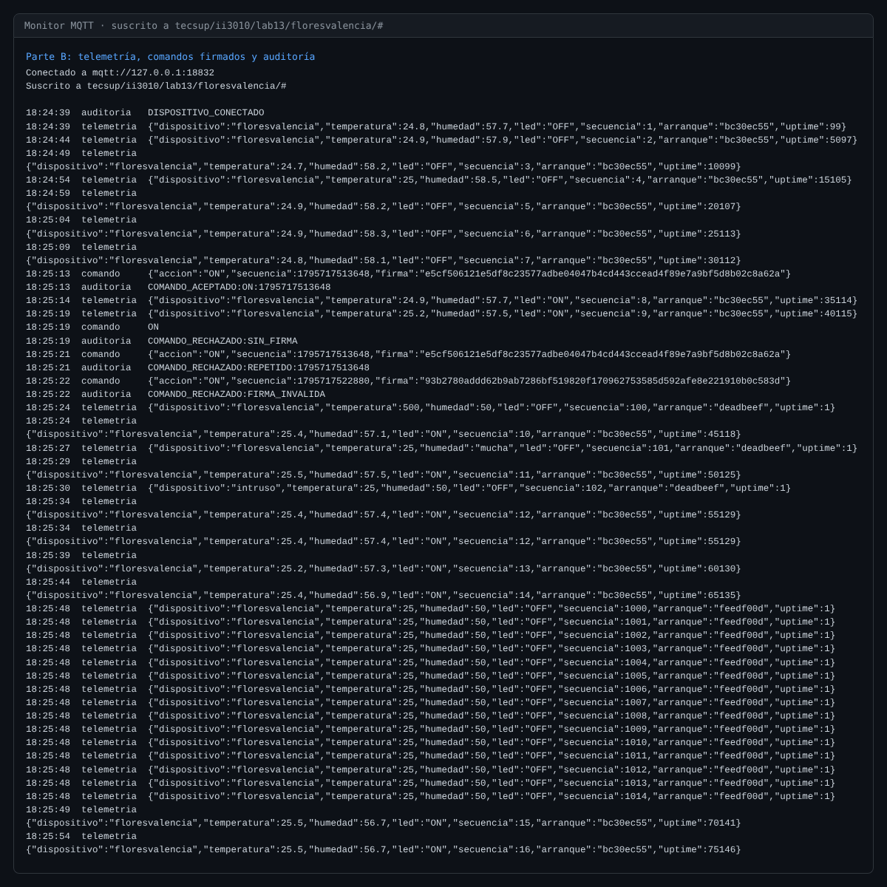
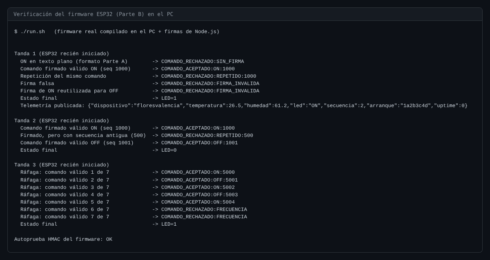

# Laboratorio 13 – Cloud computing e IoT (ESP32 + MQTT + Node-RED)

ESP32 simulado en Wokwi con un DHT22 y un LED que publica temperatura y humedad por MQTT
(`test.mosquitto.org:1883`). Node-RED muestra los datos en FlowFuse Dashboard 2.0 y controla
el LED desde botones. La **Parte A** es el desarrollo guiado y la **Parte B** es el reto de
ciberseguridad: validación de telemetría, detección de repeticiones, límite de frecuencia y
comandos firmados con HMAC-SHA256.

```
DHT22 → ESP32 → MQTT → Broker Mosquitto → Node-RED → Dashboard
LED   ← ESP32 ← MQTT ← Broker Mosquitto ← Node-RED ← Botones ON/OFF
```

Identificador usado en los topics: **`floresvalencia`**

| Topic | Uso |
|---|---|
| `tecsup/ii3010/lab13/floresvalencia/telemetria` | ESP32 → Node-RED (JSON) |
| `tecsup/ii3010/lab13/floresvalencia/comando` | Node-RED → ESP32 (`ON`/`OFF` en la Parte A, JSON firmado en la Parte B) |
| `tecsup/ii3010/lab13/floresvalencia/auditoria` | ESP32 → Node-RED (eventos) |

## Estructura

```
lab13-nodered-esp32/
├── parte_a/                    Desarrollo dirigido (estructura de la guía)
│   ├── platformio.ini
│   ├── wokwi.toml
│   ├── diagram.json
│   ├── node_red/flow_parte_a.json
│   └── src/main.cpp
├── parte_b/                    Reto de ciberseguridad
│   ├── platformio.ini, wokwi.toml, diagram.json
│   ├── include/secrets.example.h   (copiar a secrets.h con la clave real)
│   ├── node_red/flow_parte_b.json
│   └── src/main.cpp
├── herramientas/               Simulador del ESP32, observador MQTT, ataques y pruebas
│   └── test_host/              Compila el firmware real en el PC y lo cruza con Node.js
└── docs/evidencias/            Capturas y registros de las pruebas
```

> **Corrección a la guía:** el flow de ejemplo del paso A3 usa los topics `.../lab09/...` y la página
> `/lab09`, mientras que el firmware publica en `.../lab13/...`. En `flow_parte_a.json` ya están
> corregidos a `lab13` y el dashboard queda en `/dashboard/lab13`.

## Parte A: cómo ejecutarla

1. Abra la carpeta `parte_a` en VS Code, ejecute **PlatformIO: Build** (debe decir SUCCESS) y luego **Wokwi: Start Simulator**.
2. Inicie Node-RED (`node-red`), instale **@flowfuse/node-red-dashboard** desde *Manage palette*.
3. *Menú ☰ → Import*, elija `parte_a/node_red/flow_parte_a.json` y pulse **Deploy**.
4. Abra **http://localhost:1880/dashboard/lab13** y use ENCENDER / APAGAR.
5. En MQTTX suscríbase a `tecsup/ii3010/lab13/floresvalencia/#`.

## Parte B: cómo ejecutarla

1. Genere una clave (por ejemplo `node -e "console.log(require('crypto').randomBytes(24).toString('hex'))"`).
2. Copie `parte_b/include/secrets.example.h` como `secrets.h` y pegue la clave en `HMAC_KEY`.
3. Compile y simule `parte_b` en Wokwi igual que la Parte A. En el monitor serie debe aparecer `[AUTOPRUEBA] HMAC OK`.
4. Inicie Node-RED con la misma clave en la variable de entorno `LAB13_HMAC_KEY`:
   - CMD: `set LAB13_HMAC_KEY=su_clave` y luego `node-red`
   - PowerShell: `$env:LAB13_HMAC_KEY="su_clave"; node-red`
5. Desactive la pestaña de la Parte A (sus botones envían `ON` sin firma), importe `parte_b/node_red/flow_parte_b.json` y pulse **Deploy**.
6. Abra **http://localhost:1880/dashboard/lab13-seguro**. Los botones del grupo *Pruebas de seguridad* ejecutan las pruebas negativas de comandos.

### Controles de seguridad

| Control | Dónde | Cómo |
|---|---|---|
| Comandos firmados | Node-RED firma, ESP32 verifica | `firma = HMAC-SHA256(clave, "accion\|secuencia\|dispositivo")`, comparación en tiempo constante |
| Antirrepetición de comandos | ESP32 | Solo acepta una `secuencia` mayor que la última aceptada (guardada en NVS). Node-RED usa `Date.now()` como secuencia |
| Límite de comandos | ESP32 y Node-RED | 5 cada 10 s en el ESP32; 10 por minuto desde el dashboard |
| Validación de telemetría | Node-RED | Tamaño ≤ 512 B, JSON, dispositivo esperado, tipos, rangos (−40…80 °C, 0…100 %), LED ON/OFF |
| Telemetría repetida | Node-RED | Dentro de un mismo `arranque` la `secuencia` debe crecer; un `arranque` nuevo se registra como `REINICIO_ESP32` |
| Abuso de frecuencia | Node-RED | Más de 6 mensajes en 10 s se descartan (`ABUSO_FRECUENCIA`) |
| Auditoría | ESP32 y Node-RED | Tabla con los últimos 30 eventos y contadores en el dashboard |
| Secretos | Repositorio | `secrets.h` en `.gitignore`; la clave de Node-RED se lee de una variable de entorno, no del flow |

**Limitación conocida:** en esta parte solo se firman los comandos. La telemetría no va firmada, así
que alguien que publique en el broker público puede inyectar lecturas con forma válida (en la
prueba de flood, los primeros mensajes falsos se aceptaron como un reinicio). El
[Laboratorio 14](../lab14-iot-seguro/) firma también la telemetría.

## Herramientas y pruebas

```bash
cd herramientas
npm install
npm test
```
Ejecuta 10 pruebas sobre el código real de los nodos *function* del flow de la Parte B.

```bash
herramientas/test_host/run.sh
```
Compila los `main.cpp` reales de ambas partes en el PC (requiere `g++`, `libssl-dev` y `git`) y comprueba que el firmware acepta los comandos firmados por Node.js y rechaza los falsos, repetidos, sin firma y en ráfaga.

Sin Wokwi, el simulador reemplaza al ESP32 (`MQTT_URL` permite usar otro broker):
```bash
node simulador-esp32.js --parte a
node simulador-esp32.js --parte b
node observar.js
node ataques.js
node ataques.js repetir-comando
node ataques.js flood
```
La Parte B del simulador requiere `LAB13_HMAC_KEY`. `observar.js` equivale a MQTTX en consola.

## Evidencias

Las capturas se tomaron con el simulador del ESP32 y un broker MQTT local, porque desde el entorno
donde se prepararon no había acceso a `test.mosquitto.org`; el comportamiento es el mismo con el broker público.

| | |
|---|---|
|  Flow de la Parte A |  Dashboard Parte A con el LED encendido |
|  Flow de la Parte B |  Comando firmado aceptado |
|  Pruebas negativas |  Abuso de frecuencia |
|  Tráfico MQTT |  Verificación del firmware |
