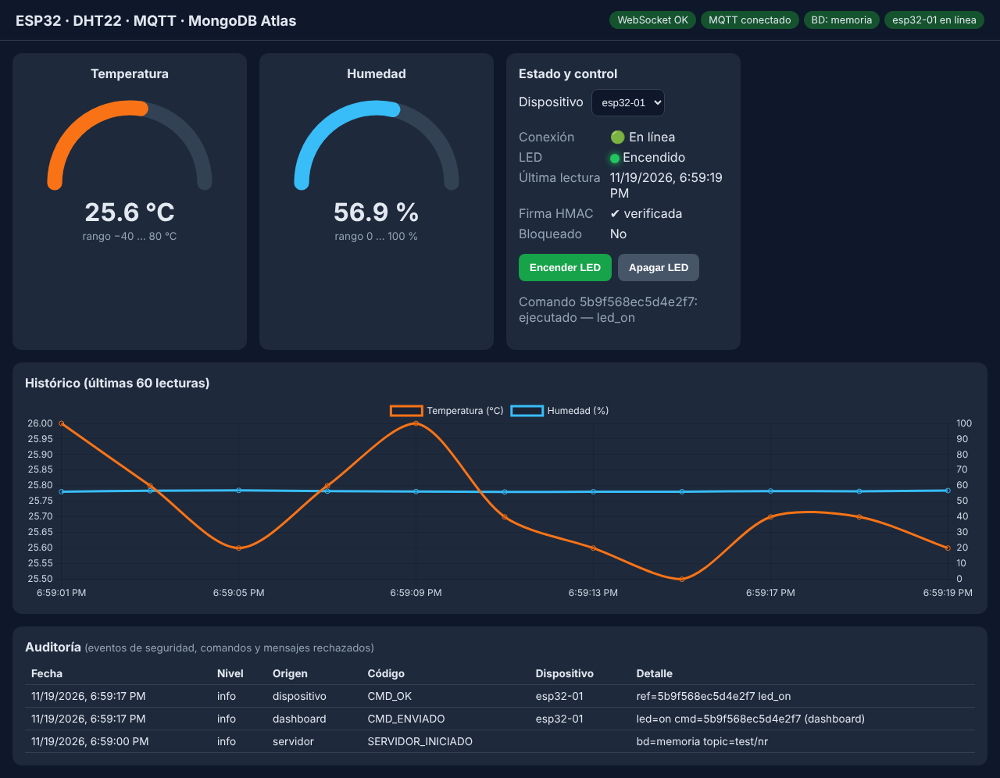
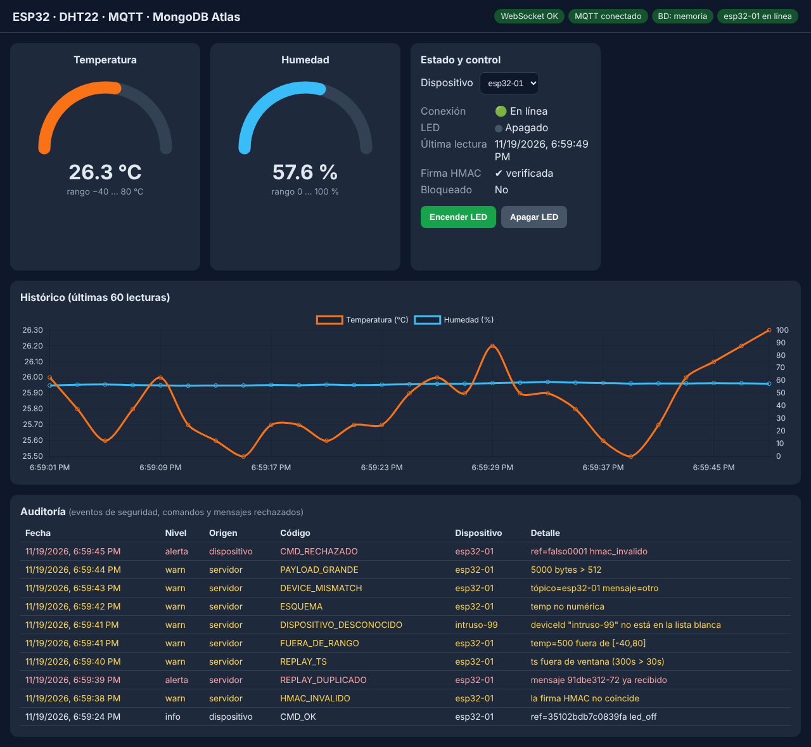
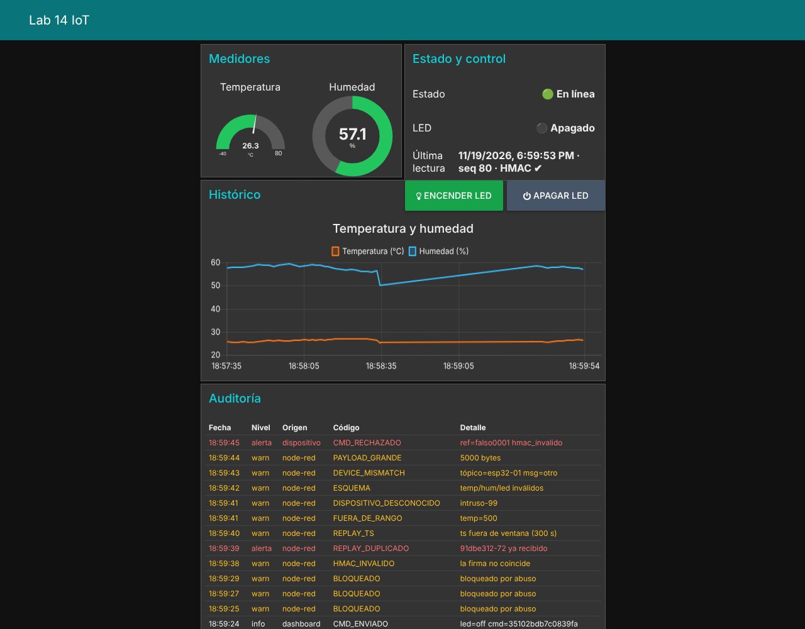
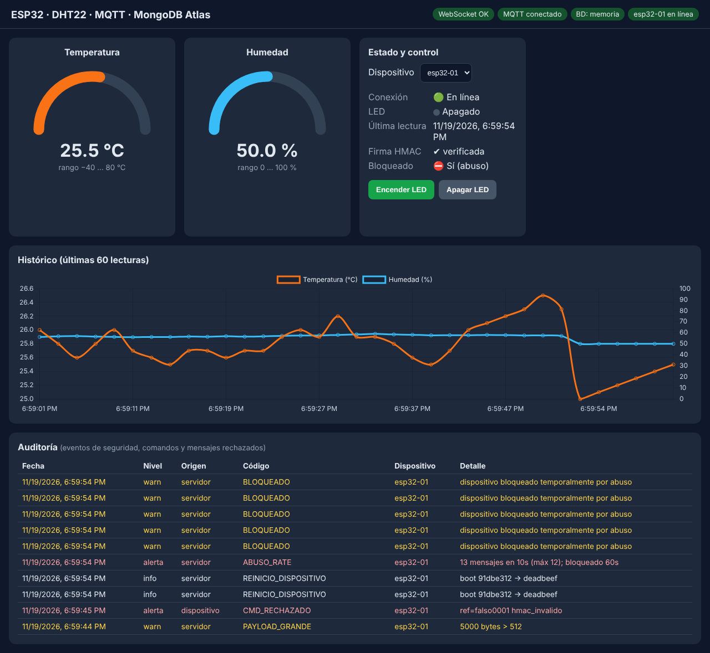
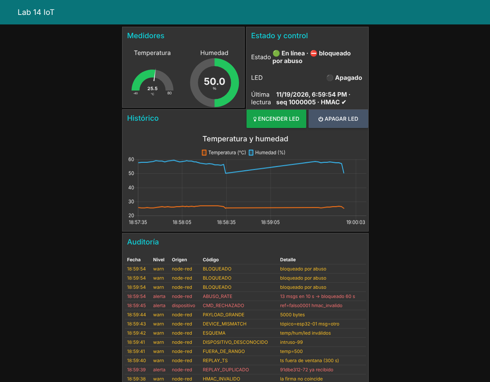

# Laboratorio 14 – Comunicación integral con IoT (versión segura)

ESP32 + DHT22 simulado en **Wokwi**, programado con **PlatformIO** (VS Code), que envía lecturas por **MQTT** a un **servidor Node.js** (WebSockets + dashboard) que las guarda en **MongoDB Atlas**, **sin que el ESP32 conozca las credenciales de la base de datos**. Incluye un flujo equivalente en **Node-RED** con dashboard.

```
 ┌──────────────┐  telemetry / audit (HMAC)   ┌───────────────┐   ┌─────────────────────────┐   ┌───────────────┐
 │ ESP32 (Wokwi)│ ─────────────────────────▶ │ Broker MQTT   │──▶│ Servidor Node.js        │──▶│ MongoDB Atlas │
 │ DHT22 + LED  │ ◀───────────────────────── │ (HiveMQ)      │◀──│ valida + guarda + WS    │   │ (solo el srv) │
 └──────────────┘        cmd (HMAC)          └───────┬───────┘   └──────────┬──────────────┘   └───────────────┘
                                                     │                      │ WebSocket (token)
                                                     ▼                      ▼
                                             ┌───────────────┐      ┌──────────────┐
                                             │ Node-RED      │      │ Dashboard web│
                                             │ + dashboard   │      │ (navegador)  │
                                             └───────────────┘      └──────────────┘
```

## Estructura

| Carpeta | Contenido |
|---|---|
| `firmware/` | Proyecto PlatformIO: `src/main.cpp`, `platformio.ini`, `diagram.json` y `wokwi.toml` (Wokwi), `include/secrets.example.h` |
| `firmware/test_host/` | Verificación del firmware en el PC (compila `main.cpp` con stubs y lo cruza con el servidor) |
| `server/` | Servidor Node.js: MQTT + Express + WebSockets + MongoDB; dashboard en `public/`; pruebas en `test/`; herramientas en `tools/` |
| `node-red/` | `flows.json`: flujo con HMAC, anti-repetición, validación, abuso y dashboard |
| `docs/evidencias/` | Capturas y logs de las pruebas positivas y negativas |

## Puesta en marcha

### 1. MongoDB Atlas
Siga la guía del laboratorio (proyecto, clúster gratuito, usuario `esp32_user` con *Read and Write*, acceso de red y **Connect → Drivers**). Copie la cadena `mongodb+srv://...`. **Solo se pega en `server/.env`, nunca en el firmware.**

### 2. Servidor
```bash
cd server
npm install
cp .env.example .env
npm run gen-secrets
```
`gen-secrets` genera la clave HMAC del dispositivo, el token del dashboard y un `TOPIC_BASE` aleatorio, y crea `firmware/include/secrets.h` con la **misma** clave. Luego edite `server/.env` y pegue su `MONGODB_URI`. Inicie el servidor con:
```bash
npm start
```
Abra `http://localhost:3000` e ingrese el `DASHBOARD_TOKEN` que está en `server/.env`.

### 3. Firmware (VS Code + PlatformIO + Wokwi)
1. Instale las extensiones **PlatformIO IDE** y **Wokwi Simulator** (necesita licencia gratuita de Wokwi).
2. Abra la carpeta `firmware/` y compile (✓ *Build*), o ejecute `pio run`.
3. `F1 → Wokwi: Start Simulator`. El circuito (`diagram.json`) tiene el DHT22 en **GPIO15** y el LED (con resistencia de 220 Ω) en **GPIO2**.
4. En el monitor serie verá `SELFTEST HMAC OK`, la conexión WiFi `Wokwi-GUEST`, la hora NTP y las lecturas `[TEL] ... enviado`.
5. Haga clic en el DHT22 en Wokwi para cambiar temperatura y humedad: el dashboard se actualiza.

### 4. Node-RED (opcional, para la rúbrica)
```bash
npm install -g node-red
cd ~/.node-red
npm install node-red-dashboard
```
Inicie Node-RED con las **mismas** variables de entorno que el servidor (los valores están en `server/.env`).

PowerShell:
```powershell
$env:TOPIC_BASE="tecsup/lab14/xxxx"; $env:DEVICE_KEYS="esp32-01:CLAVE"; node-red
```
Linux / macOS:
```bash
TOPIC_BASE=tecsup/lab14/xxxx DEVICE_KEYS=esp32-01:CLAVE node-red
```
Importe `node-red/flows.json` (menú → *Import*), pulse *Deploy* y abra `http://localhost:1880/ui`. Las claves **no** quedan guardadas en el flujo.

## Protocolo y controles de seguridad

Cada mensaje lleva `sig` = HMAC-SHA256 (clave por dispositivo) de una **cadena canónica**:

| Mensaje | Sentido | Cadena firmada |
|---|---|---|
| Telemetría | ESP32 → servidor | `T\|deviceId\|boot\|seq\|ts\|temp\|hum\|led` |
| Auditoría | ESP32 → servidor | `A\|deviceId\|boot\|seq\|ts\|event\|ref\|detail` |
| Comando | servidor → ESP32 | `C\|deviceId\|cmdId\|ts\|action\|value` |

El prefijo `T/A/C` impide reutilizar una firma de un tipo de mensaje en otro (anti-reflexión).

| Control | Dónde | Detalle |
|---|---|---|
| Credenciales de BD fuera del ESP32 | arquitectura | El ESP32 solo conoce su clave HMAC; `MONGODB_URI` vive en `server/.env` |
| Autenticidad e integridad | servidor, Node-RED, ESP32 | HMAC-SHA256 con comparación en tiempo constante |
| Anti-repetición | servidor, Node-RED, ESP32 | Ventana de ±30 s (NTP) + id único `boot-seq` / `cmdId` + ventana deslizante de `seq`; índice único en Mongo como 2ª barrera |
| Validación de telemetría | servidor, Node-RED | Tamaño ≤ 512 B, JSON, lista blanca de dispositivos, `deviceId` del tópico = del mensaje, tipos, rangos físicos (−40…80 °C, 0…100 %) |
| Detección de abuso | servidor, Node-RED, ESP32 | Rate limit de mensajes auténticos con bloqueo de 60 s; alerta por ráfagas de firmas falsas (sin bloquear al legítimo, para evitar DoS); límite de comandos (20/min en el servidor, 5/10 s en el ESP32); anomalías (saltos > 10 °C) |
| Auditoría | todos | Colección `auditoria` + tabla en los dashboards; el ESP32 publica ACK y rechazos firmados; limitador anti-inundación |
| Dashboard | servidor | Token obligatorio (WebSocket y API), CSP, `textContent` (sin XSS), límites de tamaño y tasa en WS |
| Secretos | repositorio | `.env` y `secrets.h` en `.gitignore`; plantillas sin valores reales; `gen-secrets` genera claves aleatorias |

Colecciones en MongoDB (`esp32_iot`): `telemetria`, `auditoria`, `comandos`.

## Pruebas

```bash
cd server && npm test
```
Ejecuta 14 pruebas: 13 unitarias de seguridad y 1 de integración (broker local → simulador → servidor → WebSocket → comando → ACK → ataques).

Para probar el firmware en el PC, sin ESP32 (requiere `g++` y `libssl-dev`):
```bash
firmware/test_host/run.sh
```

Pruebas manuales contra el sistema real (con Wokwi corriendo o el simulador):
```bash
npm run simulador
npm run ataques
npm run ataques -- cmd-replay
npm run ataques -- flood
```
El primer comando reemplaza al ESP32 si no usa Wokwi. `cmd-replay` le pide pulsar un botón del dashboard mientras corre.

| # | Prueba | Tipo | Resultado esperado (auditoría) |
|---|---|---|---|
| 1 | Telemetría del ESP32 | positiva | Medidores, gráfico y BD actualizados; `firmaVerificada: true` |
| 2 | Botón Encender/Apagar | positiva | `CMD_ENVIADO` → `CMD_OK` del dispositivo; LED cambia |
| 3 | Firma falsa | negativa | `HMAC_INVALIDO` |
| 4 | Reenvío de mensaje capturado | negativa | `REPLAY_DUPLICADO` |
| 5 | Mensaje firmado antiguo (300 s) | negativa | `REPLAY_TS` |
| 6 | temp = 500 °C | negativa | `FUERA_DE_RANGO` |
| 7 | Dispositivo no registrado | negativa | `DISPOSITIVO_DESCONOCIDO` |
| 8 | Tipos incorrectos | negativa | `ESQUEMA` |
| 9 | deviceId ≠ tópico | negativa | `DEVICE_MISMATCH` |
| 10 | Payload de 5000 B | negativa | `PAYLOAD_GRANDE` |
| 11 | Comando con firma falsa | negativa | ESP32: `CMD_RECHAZADO hmac_invalido`, LED sin cambio |
| 12 | Reenvío de comando legítimo | negativa | ESP32: `CMD_RECHAZADO replay` |
| 13 | Ráfaga de mensajes | negativa | `ABUSO_RATE` + `BLOQUEADO` durante 60 s |
| 14 | Token del dashboard incorrecto | negativa | `DASHBOARD_TOKEN_INVALIDO`, conexión cerrada |

Las capturas y logs de estas pruebas están en `docs/evidencias/`.

## Limitaciones y mejoras
- El broker público no cifra el tráfico: HMAC garantiza integridad y autenticidad, pero **no confidencialidad**. En producción use un broker propio con TLS (puerto 8883) y usuario/contraseña o certificados por dispositivo.
- La clave HMAC está en el firmware; en un dispositivo real debe protegerse con *flash encryption* / *secure boot* del ESP32 y rotarse periódicamente.
- Cualquiera puede publicar en un broker público y hacer ruido (DoS), aunque nunca se acepten sus datos.

## Evidencias
Las capturas de `docs/evidencias/` se tomaron con el simulador del ESP32 (`npm run simulador`), un broker MQTT local y almacenamiento en memoria; por eso el dashboard muestra "BD: memoria".

| Etapa | Dashboard Node.js | Dashboard Node-RED |
|---|---|---|
| 1. Prueba positiva (telemetría + LED) |  |  |
| 2. Ataques (firma, replay, rangos, esquema...) |  |  |
| 3. Flood (abuso y bloqueo) |  |  |
